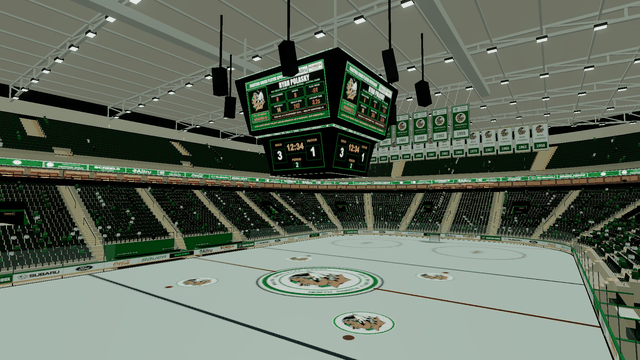

# Ralph Engelstad Arena (Fighting Sioux) for Puck

A Fighting Sioux-era Ralph Engelstad Arena ("The Ralph") custom arena for
[Puck](https://store.steampowered.com/app/2994020/Puck/). Full lower bowl,
championship banners, center-hung jumbotron, Sioux center-ice crest, and a
3D positional goal horn with fight songs ("Stand Up and Cheer",
"Fight on Sioux").

  

[Subscribe on the Steam Workshop](https://steamcommunity.com/sharedfiles/filedetails/?id=3826743382)

Requires [Arena Loader](https://steamcommunity.com/sharedfiles/filedetails/?id=3802863574).
